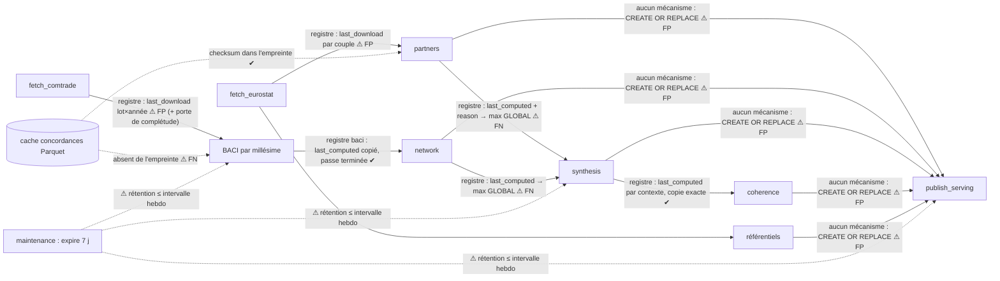

# Audit des watermarks aval et plan de parcimonie

> **Date** : 2026-10-14 · **Branche** : `qb-vulnerabilities` · **Statut** : étapes 0 à 3 implémentées
> le 2026-10-15 (§10) ; bascule faite et modes de transition retirés (K-17c, §10.2).
>
> **Objet** : rendre le pipeline aussi parcimonieux que possible. Chaque étape ne recalcule que ce
> qui a changé depuis son dernier run réussi, sans jamais rater un changement. Le plan s'appuie sur
> `statflows` 0.2.2 (`last_modified`, `last_modified_snapshot`, `changes_since`,
> `write_dataframe_with_report`) et sur l'extension `changes_since(key_columns, until_snapshot)`
> proposée (§6) et publiée dans `statflows` **0.3.0**.
>
> **Documents liés** :
> - `statflows-0.2.2-contexte-aval.md` : nouveautés de statflows 0.2.2 ;
> - `EXTENSION_PARCIMONIE_AVAL.md` : extension aux étapes hors du premier périmètre, gains et
>   mise en œuvre, pour décision ;
> - `PIPELINE_ARCHITECTURE.md` : PD-10, PD-12, PD-16, PS-10 (à mettre à jour avec l'implémentation).

## Sommaire

1. [Synthèse](#1-synthèse)
2. [Cartographie du pipeline](#2-cartographie-du-pipeline)
3. [Audit des mécanismes existants](#3-audit-des-mécanismes-existants)
4. [Décisions](#4-décisions)
5. [Plan cible (étapes 0 à 3)](#5-plan-cible-étapes-0-à-3)
6. [Proposition statflows 0.2.3 (publiée en 0.3.0)](#6-proposition-statflows-023-publiée-en-030)
7. [Gestion d'une erreur méthodologique](#7-gestion-dune-erreur-méthodologique)
8. [Vérification](#8-vérification)
9. [Changements par fichier](#9-changements-par-fichier)
10. [Implémentation et bascule](#10-implémentation-et-bascule)

---

## 1. Synthèse

Le dépôt dispose déjà d'un mécanisme de fraîcheur solide, `kedro_pipeline/io/freshness.py` :
- chaque étape aval tient un registre JSON fragmenté par unité de travail ;
- chaque entrée porte des empreintes méthodologiques, c'est-à-dire un hash des paramètres ;
- l'écriture est atomique (`Saver` de statflows), et le registre n'est enregistré qu'après la
  réussite du calcul et de l'écriture de la table ;
- un forçage ponctuel et une invalidation persistante sont disponibles.

Le plan **complète** ce mécanisme sans le remplacer. Il corrige trois problèmes :

1. **Faux positifs coûteux.** Les partenaires (chaque jour) et BACI (chaque semaine), qui sont les
   deux étapes les plus chères, se déclenchent sur `last_download`. Or `last_download` avance à
   chaque téléchargement, même quand rien n'a changé.
2. **Deux faux négatifs dans la synthèse** (FN-1, FN-2). Supprimer les faux positifs en amont les
   **démasquerait** : aujourd'hui, ils se résorbent seulement parce que les partenaires
   recalculent tous les jours.
3. **Rétention des snapshots (7 j) trop courte.** Elle est inférieure ou égale à l'intervalle entre
   deux runs hebdomadaires, ce qui rendrait `changes_since` inutilisable pour les étapes
   hebdomadaires.

**Versions.** `pyproject.toml:120` fixe `statflows` `v0.2.1`, et le `.venv` contient la 0.2.0. Le
déploiement de ce plan requiert l'extension du §6, publiée dans `statflows` **0.3.0** (dépendance
montée à `v0.3.0`).

---

## 2. Cartographie du pipeline

| Étape (nœud Kedro / script) | Cadence | Entrées | Sorties | Déclenchement actuel | Recalcul |
|---|---|---|---|---|---|
| `fetch_eurostat` / `download_eurostat_comext.py` | quotidienne | API Eurostat, registre `DOWNLOADS` | `eurostat.<DS_045409>.fact_table`, registre (`last_download`) | `statflows.download_updates`, incrémental sur les 10 dernières observations (`N_LAST_OBSERVATIONS`) | par requête |
| `fetch_comtrade` / `download_comtrade.py` | quotidienne | API Comtrade, registre | `comtrade.C_A_HS.fact_table`, registre (fragments par année) | idem | par requête (année × lot de produits) |
| `publish_reference_*` | quotidienne | listes de codes | schémas de référence (`write_dataframe`, upsert) | aucun : réécrits à chaque run | complet, upsert idempotent |
| `audit_coverage_*` | quotidienne | registre (`last_download`, `steps/coverage.py:222`) | métriques MLflow | aucun | complet |
| `prepare_baci` + `process_baci_<V>` | hebdomadaire | registre Comtrade (`batches_by_year`), fichiers CEPII, cache des concordances (Parquet S3), registre `state.baci` | `comtrade.baci_hs<V>` (par année : suppression puis réécriture, colonne `fit_id`), registre baci | porte de complétude, puis `units_to_compute` + `baci_is_new_data` : `last_download` max des lots du millésime, `MIN_INTERVAL_DAYS = 7` | millésime entier |
| `compute_partner_vulnerabilities` | quotidienne | Comext, registre `DOWNLOADS` (`pairs_last_download`), concordances, `state.partners` | `vulnerabilities.indicators` (upsert sans suppression), registre partenaires | `last_download` du couple > `upstream_watermark`, ou empreinte | couple (reporter × produit), toutes périodes |
| `compute_network_vulnerabilities` | hebdomadaire | `baci_hs<V>`, registre baci (lecture) | `vulnerabilities.network_indicators` (upsert sans suppression), registre réseau | `last_computed` BACI du millésime > watermark (passe terminée seulement) | millésime entier |
| `compute_synthetic_scores` | hebdomadaire | `indicators` ⋈ `network_indicators`, registres partenaires et réseau | `synthesis` + `synthesis_diagnostics` (famille `fit`), suppression puis upsert par méthode | `UpstreamMarks` : changement complet pertinent, ou `new_data` partenaires sur les `RECENT_PERIODS` dernières périodes ; empreinte par méthode | contexte `(hs_vintage, freq, flow, indicators, TIME_PERIOD)` |
| `compute_synthesis_coherence` | hebdomadaire | `synthesis`, registre synthèse | `synthesis_diagnostics`, registre cohérence | `last_computed` synthèse du contexte > watermark | contexte |
| `publish_serving` | quotidienne et hebdomadaire | toutes les tables ci-dessus et les référentiels | catalogue `serving` (`CREATE OR REPLACE`) | **aucun** (`MODE: full`) | complet |
| `maintain_ducklake` | `onExit` quotidien | catalogues | expiration des snapshots (7 j), compaction, nettoyage | — | — |

Les autres scripts sont des enveloppes des mêmes fonctions d'étape : `invalidate_freshness.py`, et
les démos `complete_synthetic_comext.py` / `seed_synthetic_comtrade.py`. Les notebooks ne sont pas
de la production.



**Points solides vérifiés**
- **Ordre des écritures.** Chaque registre est écrit après la réussite du calcul et de l'écriture
  de la table : `partners.py:1145-1146`, `network.py:786-800`, `baci.py:2128` (entrée « démarrée »)
  puis `2203-2212`, `synthesis.py:2648-2658` (par lot), `coherence.py:849-861`.
- **Atomicité.** Les registres JSON sont écrits par le `Saver` de statflows, de façon atomique.
- **Côté statflows.** Une entrée du registre de téléchargement n'avance jamais avant le commit
  DuckLake correspondant (`statflows/core/download.py:383-385`).

---

## 3. Audit des mécanismes existants

### 3.1 Faux négatifs (changements ratés)

**FN-1 — Élevée — la synthèse compare des instants hétérogènes capturés avant le calcul**

- **Mécanisme.**
  - Le watermark enregistré sur chaque contexte vaut `marks.watermark`, le **max global** de tous
    les `last_computed` partenaires et réseau (`synthesis.py:1395-1417`, `2650`).
  - La décision compare ensuite des marques **par clé** à ce max (`synthesis.py:1555-1563`).
  - Or un `last_computed` est capturé au **début** du calcul de l'étape amont, alors que son entrée
    n'est enregistrée qu'à la **fin**.
- **Scénario.**
  1. Une passe partenaires quotidienne démarre à 07:00.
  2. Le réseau hebdomadaire démarre à 08:00 et se termine.
  3. La synthèse lit les marques à 09:00 : W = 08:00.
  4. La passe partenaires enregistre son entrée à 10:00, avec `last_computed` = 07:00 < W.
  5. Le changement n'est jamais vu.
- **Fréquence.** Le recouvrement des workflows quotidien et hebdomadaire est documenté comme
  possible (`PIPELINE_ARCHITECTURE.md` §2.3).

**FN-2 — Élevée — l'heuristique `RECENT_PERIODS`** (`synthesis.py:1551-1563`, `parameters_synthesis.yml:60`)

- Un `new_data` partenaires ne recalcule que les 10 dernières périodes de la grille.
- Des périodes anciennes peuvent pourtant changer sans que la raison soit `first` :
  - re-téléchargement complet après un changement de découpage des requêtes (nouvelle clé de
    registre, couple déjà connu) ;
  - réinitialisation du registre ;
  - passe historique `new_data`.
- Ces révisions sont ratées.
- Corollaire latent : `recent_period_values` (`1504-1506`) et `select_contexts` (`1600`) trient les
  `TIME_PERIOD` de façon lexicographique. Le résultat est faux si `freq` mélange A et M. Aujourd'hui,
  seul `freq = 'A'` est retenu.

**FN-3 — Moyenne — les suppressions ne sont pas propagées**

- Partenaires et réseau ne font que des upserts (`tradestat/trade/vulnerabilities/runner.py:131`,
  `partners.py:1111-1115`, `network.py:742-747`).
- Une cellule qui disparaît reste en table. Exemples :
  - code partenaire retiré ;
  - produit ou année absent après une réestimation BACI ;
  - filtre modifié qui déclenche le recalcul via l'empreinte.
- Même chose pour un contexte qui sort de la grille de synthèse.
- En amont, statflows ne supprime pas non plus les observations retirées par le fournisseur.
- Traitement : hors du premier périmètre, voir `EXTENSION_PARCIMONIE_AVAL.md` §2.

**FN-4 — Moyenne — l'empreinte BACI n'intègre ni les concordances ni les fichiers CEPII** (`baci.py:1380-1400`)

- Les partenaires intègrent bien le checksum des concordances (`partners.py:867`), pas BACI.
- Un rafraîchissement UNSD (`FORCE_REFRESH`) ou un remplacement de `dist_cepii.xls` ne relance aucun
  millésime.

**FN-5 — Moyenne — le code n'est pas dans les empreintes** (`freshness.py:206-236`)

- C'est un choix de PD-10 : une correction de formule passe par une invalidation manuelle.
- Le risque est l'oubli de cette invalidation. Traité par la décision Q1 (§4, §7).

**FN-6 — Moyenne (exactitude) — lectures non épinglées pendant des écritures concurrentes**

- **BACI.** Le redressement lit Comtrade en plusieurs passes alors que le téléchargement quotidien
  peut écrire entre deux passes. Les statistiques suffisantes mélangent alors deux versions des
  données.
  - Le watermark enregistré est l'ancien, donc rien n'est perdu.
  - Mais la sortie reste incohérente au moins `MIN_INTERVAL_DAYS` (7 j).
- **Synthèse.** Même problème, en moindre mesure, quand elle lit `indicators` pendant une passe
  partenaires.

**FN-7 — Faible aujourd'hui, élevée dès que `changes_since` sera utilisé — rétention des snapshots** (`parameters_maintenance.yml:25`)

- La rétention est de 7 j. Les consommateurs hebdomadaires repassent tous les 7 j, avec une fenêtre
  d'exécution de 6 j.
- `changes_since` lèverait donc presque toujours une `ValueError`, ce qui force un recalcul complet.
  Ce n'est pas une perte de changement, mais la parcimonie disparaît.
- Autre point : la maintenance `onExit` quotidienne peut tourner pendant les écritures
  hebdomadaires. Le mutex ne couvre que la maintenance et `publish_serving`.

**FN-8 — Faible — les dates du registre suivent l'ordre de capture, pas l'ordre de commit**

- Le watermark d'un couple partenaires est le max des dates des requêtes qui le couvrent
  (`io/registry_views.py:154-177`).
- Deux requêtes chevauchantes commitées dans l'ordre inverse de leurs instants de capture peuvent se
  masquer. Il faut pour cela deux téléchargements du même dataflow en parallèle.
- `last_modified_snapshot`, qui suit l'ordre des commits, élimine ce cas.

**Non-problèmes vérifiés**
- Le report de la cadence BACI (`MIN_INTERVAL_DAYS`) est un retard voulu, pas une perte : le
  watermark n'avance pas.
- Le reliquat du budget `MAX_CONTEXTS_PER_RUN` n'est pas perdu, puisqu'aucune entrée n'est écrite.
- Une passe BACI interrompue est détectée par `years_written` / `fit_id`.
- La cohérence compare des copies exactes, contexte par contexte.

### 3.2 Faux positifs (recalculs inutiles)

| # | Où | Effet | Coût |
|---|---|---|---|
| FP-1 | Partenaires sur `last_download` (`registry_views.py:176-177`, `partners.py:1336-1341`) | Tout couple re-téléchargé est recalculé chaque jour, alors qu'Eurostat renvoie les 10 dernières observations même inchangées | élevé, quotidien |
| FP-2 | BACI sur `last_download` (`baci.py:1485-1506`, `1990`) ; de plus, `fit_id` intègre le watermark (`1509-1543`) | En régime nominal, chaque millésime est réestimé chaque semaine | **le plus élevé** |
| FP-3 | Réécriture BACI par suppression puis insertion de chaque année, avec la colonne `fit_id` (`baci.py:1112-1119`, `2167`) | Toutes les lignes apparaissent modifiées dans `ducklake_table_changes`, même à l'identique | bloque la parcimonie DuckLake en aval de BACI |
| FP-4 | Réseau | Recalcul après chaque passe BACI, même sans changement de valeurs | élevé, disparaît avec FP-2 |
| FP-5 | Synthèse | Une seule passe partenaires suffit pour recalculer tous les contextes en vigueur des 10 dernières périodes | élevé |
| FP-6 | Écriture de la synthèse par suppression puis upsert (`synthesis.py:1890-1906`) | Réécrit des lignes identiques | ne compte que si la cohérence passe à `changes_since` |
| FP-7 | Serving : `MODE: full`, `CREATE OR REPLACE` (`io/serving.py:293`) | Reconstruction complète deux fois par cycle | moyen |

### 3.3 Granularité, premier run, backfill, reprise

- **Granularité.** Elle est adaptée partout (couple, millésime, contexte). Seule la synthèse est
  trop grossière : ses clés de pertinence couvrent « tout le flux en vigueur ».
- **Premier run.** C'est la raison `first`, et il est correct.
- **Backfill.** Il est correct, via la cadence BACI et le budget de la synthèse.
- **Reprise après échec.** Elle est correcte, puisque les registres sont écrits après succès.

---

## 4. Décisions

| # | Question | Décision |
|---|---|---|
| Q1 | Code dans l'empreinte | Option la plus simple pour l'exploitation et la moins sujette à erreur : **verrou méthodologique contrôlé en CI** (§7). Le développeur tranche au moment du commit, la CI l'y oblige, et la production n'a rien à faire : la révision entre dans les empreintes et la passe planifiée suivante recalcule. La gestion d'une erreur méthodologique est documentée au §7 et dans le runbook. |
| Q2 | Clés touchées | Extension **dans statflows** (§6), publiée en **0.3.0** avant le redéploiement de ce dépôt. Pas de helper local. |
| Q3 | Rétention des snapshots | **Expiration bornée par les curseurs** (§5.5). |
| Q4 | Périmètre | **Étapes 0 à 3** dans un premier temps. L'extension aux autres étapes est spécifiée, chiffrée et décrite dans `EXTENSION_PARCIMONIE_AVAL.md`, pour décision. |

---

## 5. Plan cible (étapes 0 à 3)

### 5.1 Principe : un curseur par (étape, catalogue, schéma), avancé en deux phases

Nouveau module `kedro_pipeline/io/cursors.py`. Il réutilise `FreshnessRegistry` et le `Saver`
atomique ; ce n'est pas un nouveau format.
- **Emplacement.** Un fichier par étape, `trade/state/<étape>/_cursors.json` (paramètre
  `STATE.CURSOR_PATH`).
- **Contenu.** Une unité par `(catalog, schema)` lu :

```json
{
  "unit": {"catalog": "vulnerabilities", "schema": "indicators"},
  "snapshot": 18452,
  "fingerprint": "<empreinte de la sélection lue : SOURCES, FILTERS, colonnes clés>",
  "updated_at": "2026-10-14T03:12:44+00:00"
}
```

- **Empreinte du curseur.** Elle ne couvre que ce dont dépend la **lecture des changements** :
  schéma lu, colonnes clés, filtres de sélection. Les empreintes **par unité** (métrique, méthode,
  révision méthodologique) restent dans les registres d'unités existants et gèrent finement les
  changements de méthodologie.

**Reprise en deux phases.** Elle avance le curseur sans jamais perdre de changement, même en cas
d'échec partiel ou de budget :

1. Épinglage : `pinned = current_snapshot(conn, alias)`.
2. Lecture des changements : `changes = changes_since(conn, alias, schema, cursor.snapshot,
   key_columns=[...], until_snapshot=pinned)`. On en déduit les unités touchées.
3. Les unités touchées sont **marquées `pending`** dans le registre d'unités (champ
   `pending_since`, raison `pending`), puis `registry.save()`.
4. Le curseur passe à `changes.current_snapshot`, puis `cursors.save()`.
5. Les unités en attente sont calculées, avec lecture `AT (VERSION => pinned)` quand l'étape lit
   plusieurs fois ou plusieurs tables.
6. Le marqueur `pending` est retiré de chaque unité réussie, avec l'enregistrement habituel de son
   entrée.

Comportement en cas d'incident :
- **Crash entre 3 et 4** : les mêmes changements sont relus, ce qui est idempotent.
- **Échec ou budget épuisé en 5** : les unités restent `pending` pour le run suivant.
- **Repli** (`ValueError` de `changes_since` pour snapshots expirés, curseur absent, ou empreinte de
  curseur changée) : toutes les unités candidates sont marquées `pending`, puis le curseur est
  réinitialisé à `pinned`.

### 5.2 Étape 0 — socle, sans changement de comportement

- `statflows` passe en `v0.3.0` (`pyproject.toml`, `uv.lock`).
- Création de `kedro_pipeline/io/cursors.py` : `StepCursors` (chargement, `read_changes()` avec
  repli, marquage `pending`, avancement, validation).
- Dans `kedro_pipeline/io/freshness.py` :
  - champ `pending_since` dans `RegistryEntry` ;
  - raison `pending` dans `units_to_compute`, avec la priorité `first > forced > pending > new_data
    > fingerprint` ;
  - prédicat `upstream_mark_is_newer` ;
  - marque amont structurée (`UpstreamMark` : date de modification et snapshot).
- Verrou méthodologique : `kedro_pipeline/methodology.lock`, `kedro_pipeline/methodology.py`, test de CI (§7).
- Expiration bornée par les curseurs dans `kedro_pipeline/io/maintenance.py` (§5.5).

### 5.3 Étape 1 — synthèse (en premier, à cause de FN-1)

- **Curseurs.** Ils portent sur `vulnerabilities.indicators` (clés `classification`,
  `TIME_PERIOD`, `flow`, `indicators`, `freq`) et sur `vulnerabilities.network_indicators` (clés
  `classification`, `year`).
- **Correspondance avec les contextes.** Les clés touchées sont rapportées aux contextes
  `(hs_vintage, freq, flow, indicators, TIME_PERIOD)` :
  - une ligne partenaire **en vigueur** concerne le `hs_vintage` en vigueur de son année ;
  - une ligne **historique** concerne son millésime ;
  - une ligne réseau `(V, year)` concerne les contextes de `V` à la période `year`.

  Il n'y a pas de fenêtre temporelle : `TIME_PERIOD` est une clé de contexte, et la normalisation
  comme les rangs sont propres au contexte.
- **Suppressions.** `UpstreamMarks`, `RECENT_PERIODS` et le max global disparaissent, ce qui corrige
  FN-1, FN-2 et FP-5.
- **Épinglage.** Toutes les lectures se font au même snapshot `pinned`. `indicators` et
  `network_indicators` sont dans le même catalogue, donc un seul épinglage suffit.
- **Premier run.** Le curseur est absent : repli complet, puis curseur initialisé au snapshot `pinned` lu au
  **début** du run. Les runs suivants décident par curseur.
- **Inchangé.** Les empreintes par méthode, le budget et la cadence.

### 5.4 Étapes 2 et 3 — partenaires et BACI

**Partenaires.**
- Les unités sont construites depuis `DownloadRegistryView.pairs_last_modified()` :
  - max des `last_modified_snapshot` des requêtes couvrant le couple ;
  - pour les entrées dont le snapshot est inconnu, la date `last_modified` fait foi.
- Règle : le couple est périmé si `snapshot > stored.snapshot` ou si `last_modified >
  stored.upstream_watermark`. Un `last_modified` nul signifie qu'aucune donnée n'a jamais été écrite :
  l'unité n'est pas créée tant qu'il reste nul.
- Pas de curseur DuckLake : le registre donne déjà la granularité par couple.

**BACI.**
- Le watermark d'un millésime devient le max `last_modified_snapshot` des lots de ses années, avec
  le même repli par dates.
- La **porte de complétude reste sur `last_download`** : elle teste « téléchargé au moins une
  fois ».
- Le `fit_id` devient stable de lui-même : il reste identique tant que les données ne changent pas.
- L'empreinte intègre un hash du contenu des fichiers CEPII. Les tables de passage sont suivies
  **par millésime** : chaque passe enregistre les sommes de contrôle des tables qu'elle a
  utilisées, et un rafraîchissement de l'une d'elles réestime ce seul millésime. Une empreinte
  couvrant tout le cache réestimerait BACI chaque fois que l'étape partenaires télécharge une
  table dont BACI ne se sert pas. Ce mécanisme corrige FN-4. Au déploiement, on attend **un**
  recalcul de chaque millésime, à planifier.
- Les lectures Comtrade sont épinglées `AT (VERSION => pinned)` (corrige FN-6).

**Réseau.** Inchangé. La cascade exacte sur le registre BACI suffit, et BACI ne repasse plus à vide.

### 5.5 Expiration bornée par les curseurs

`maintain_ducklake` lit tous les `_cursors.json` et les watermarks par unité qui sont des
snapshots. Pour chaque catalogue, il n'expire que les snapshots :

- antérieurs au plus petit curseur actif du catalogue, **et**
- plus vieux que `SNAPSHOT_RETENTION_DAYS` (inchangé : 7 j).

Un plafond `MAX_SNAPSHOT_RETENTION_DAYS` (35 j proposés) empêche qu'un consommateur abandonné bloque
la maintenance. Au-delà du plafond, l'expiration a lieu quand même et le consommateur retard passe
par le repli complet. La métrique `maintenance/<catalog>/oldest_cursor_age_days` et une alerte
au-delà de 80 % du plafond le rendent visible.

### 5.6 Mode d'observation (retiré)

Le plan prévoyait un réglage `STATE.DECISION_MODE` (`legacy`, `shadow`, `snapshot`) pour basculer des anciennes
règles (`last_download`, marques des registres amont, `RECENT_PERIODS`) vers les nouvelles en observant l'écart.
La production repartant de bases vierges, il a été retiré (§10.2) : la décision sur les données modifiées est la
seule règle.

### 5.7 Ordre de bascule (sans objet)

Sans anciennes règles à abandonner, il n'y a plus d'ordre de bascule : les étapes 0 à 3 sont actives ensemble.

---

## 6. Proposition statflows 0.2.3 (publiée en 0.3.0)

La proposition est déposée dans le dépôt local `statflows`, sur la branche
**`feat/changes-since-keys`**, sans commit. Les tests passent (699 tests, ruff, mypy).

**API ajoutée** (`statflows/storage/ducklake/tables.py`)

```python
def current_snapshot(conn, catalog_alias) -> int | None: ...

def changes_since(
    conn, catalog_alias, schema, since_snapshot, *,
    table="fact_table", time_column="TIME_PERIOD",
    key_columns: Sequence[str] | None = None,   # nouveau
    until_snapshot: int | None = None,          # nouveau
) -> TableChanges

@dataclass(frozen=True)
class TableChanges:
    ...
    key_columns: tuple[str, ...] = ()                       # nouveau
    changed_keys: frozenset[tuple[Any, ...]] | None = None  # nouveau
```

**`key_columns`.** Renvoie les tuples distincts de ces colonnes parmi :
- les lignes insérées ;
- les deux images des lignes mises à jour ;
- les lignes supprimées.

Les noms sont résolus sans tenir compte de la casse. La valeur est `None` si aucune clé n'est
demandée, et un ensemble vide si rien n'a changé ou si la table est absente. Au premier run
(`since_snapshot=None`), ce sont toutes les clés de la table.

**`until_snapshot`.** Fixe la borne supérieure, en général le snapshot auquel l'étape épingle ses
lectures. Elle est contrôlée : `ValueError` si elle est en avance sur le catalogue. Le premier run
lit la table `AT (VERSION => until_snapshot)`.

**Compatibilité.** Les appels existants sont inchangés. Les nouveaux champs ont des valeurs par
défaut neutres.

**Tests ajoutés** (`tests/integration/storage/ducklake/test_changes_since.py`) :
- clés touchées, suppressions et pré-images comprises ;
- premier run ;
- épinglage face à une écriture concurrente ;
- bornes et colonnes invalides.

**Documentation.** Mise à jour de `docs/downloads.md` (section « Touched slices and pinned reads ») et
de `docs/storage.md`. Le `CHANGELOG` et la version restent à la charge de release-please, avec par
exemple le message `feat(ducklake): touched keys and pinned upper bound in changes_since`.

---

## 7. Gestion d'une erreur méthodologique

### 7.1 Verrou méthodologique (décision Q1)

**Problème.**
- Les empreintes couvrent les **paramètres**, pas le **code**.
- Hacher le code brut serait trop sensible : un commentaire suffirait à tout recalculer.
- Une invalidation manuelle en production peut s'oublier.

**Solution retenue.** Un fichier versionné `kedro_pipeline/methodology.lock`, contrôlé par la CI. Il
vit dans le paquet (et non à la racine) pour être embarqué dans l'image : la production lit les
révisions sans dépendre de l'arborescence du dépôt.

```yaml
# methodology.lock — généré par `python -m kedro_pipeline.methodology lock`
HHI:
  sources: ["tradestat/trade/vulnerabilities/metrics.py::HerfindahlHirschmanIndex",
            "tradestat/trade/vulnerabilities/base.py"]
  code_hash: 3f9a1c0e5b7d2e11
  revision: 0
baci:
  sources: ["tradestat/trade/processing/baci.py", "kedro_pipeline/steps/baci.py"]
  code_hash: 0c77d1f3e9a24b58
  revision: 2
```

**Fonctionnement.**

1. **Déclaration.** `kedro_pipeline/methodology.py` déclare, pour chaque nom méthodologique (une
   métrique partenaire ou réseau, l'étape BACI, une méthode de synthèse, la cohérence), les objets
   ou modules de code dont dépendent ses valeurs.
2. **Hash.** `code_hash` est calculé sur l'**AST normalisé** : commentaires, docstrings et mise en
   forme sont ignorés. Un changement purement cosmétique ne déclenche donc rien.
3. **Contrôle en CI.** Le test `tests/test_methodology_lock.py` recalcule les hashs. Si l'un diffère
   du verrou, la CI échoue avec un message qui laisse **deux choix explicites** au développeur :
   - `python -m kedro_pipeline.methodology lock --bump HHI` : le changement modifie les valeurs. On
     incrémente `revision` et on met à jour `code_hash` ;
   - `python -m kedro_pipeline.methodology lock --accept HHI` : le changement est sans effet sur les
     valeurs (refactorisation, performance). On met à jour `code_hash` seulement.
4. **Effet en production.** `revision` entre dans les paramètres de l'empreinte du nom concerné,
   uniquement si elle est supérieure à 0. Ce choix évite un recalcul global au déploiement du
   verrou.
   - Après un `--bump`, la passe planifiée suivante trouve une empreinte différente et recalcule
     ce nom sur **toutes** les unités, avec la raison `fingerprint`.
   - La cascade aval (`fingerprint` vaut changement complet) et la persistance (un run en échec est
     rejoué) fonctionnent comme aujourd'hui.
   - **Aucune action n'est nécessaire en production.**

**Ce qui reste manuel.** `scripts/invalidate_freshness.py` est conservé pour un recalcul
**restreint à un périmètre** : erreur ne touchant que certaines unités, données sources corrigées
pour un reporter, etc.

### 7.2 Runbook : que faire selon le type d'erreur

| Situation | Action | Effet |
|---|---|---|
| Erreur de **formule** (code d'une métrique, d'une méthode, de BACI) | Corriger, puis `lock --bump <nom>`, puis merger et déployer | Recalcul automatique de `<nom>` partout à la passe suivante, avec cascade aval |
| **Refactorisation** sans effet sur les valeurs | `lock --accept <nom>` | Aucun recalcul |
| Erreur de **paramètre** (YAML) | Corriger le paramètre | L'empreinte change, recalcul automatique du nom concerné |
| Erreur limitée à un **périmètre** (reporters, millésimes, périodes) | `invalidate-freshness-script --step <étape> --metrics <nom> --reporters …` | Recalcul du seul périmètre, persistant jusqu'au succès |
| Erreur de **nomenclature / concordance** | Rafraîchir la table UNSD (`FORCE_REFRESH`) | Le checksum change et les partenaires historiques comme BACI recalculent (FN-4 corrigé) |
| **Donnée source** erronée corrigée par le fournisseur | Rien, ou un re-téléchargement forcé dans statflows | Lignes modifiées, donc `last_modified` / `changes_since`, donc cascade |
| Doute sur l'état d'une étape | `invalidate-freshness-script --reset-cursor --step <étape>` | Repli complet de l'étape au run suivant |
| Recalcul urgent hors planification | Forçage `FORCE_STEPS` / `FORCE_METRICS` (éphémère) | Recalcul immédiat ; à doubler d'un `--bump` si le code a changé |

Le runbook §5.3 de `PIPELINE_ARCHITECTURE.md` sera réécrit selon ce tableau.

---

## 8. Vérification

Les tests tournent sur un catalogue DuckLake fichier temporaire (`FileConnectorFactory`,
`kedro_pipeline/io/ducklake.py:475`).

| Test | Vérifie |
|---|---|
| `tests/test_cursors.py` | Premier run ; run sans changement (curseur qui avance, aucune unité `pending`) ; snapshots expirés (tout `pending`, puis réinitialisation) ; crash entre le marquage et l'avancement ; empreinte de curseur changée |
| `tests/test_freshness.py` (extension) | Raison `pending`, priorités, règle `upstream_mark_is_newer` |
| `tests/test_registry_views.py` (extension) | `pairs_last_modified` ; `last_modified` nul |
| `tests/test_synthesis_overlap.py` | Reproduction de FN-1 : échoue sur le code actuel, passe après correction |
| `tests/pipeline/test_parsimony_e2e.py` (`slow`) | (a) aucun changement en entrée : aucune étape ne recalcule et les curseurs avancent (couvert par `tests/pipeline/test_kedro_run.py`) ; (b) révision d'un seul couple sur une période ancienne : seuls ce couple et les contextes de cette période sont recalculés, et le résultat est **identique** à un recalcul complet ; (c) étape en échec puis reprise ; (d) snapshots expirés : repli complet ; (e) paramètre modifié : recalcul ciblé ; (f) écriture concurrente pendant la synthèse : ignorée grâce à l'épinglage, puis traitée au run suivant |
| `tests/test_baci_steps.py` (extension) | Watermark `last_modified` ; porte de complétude toujours sur `last_download` ; empreinte sensible aux concordances et à CEPII ; `fit_id` stable sans modification |
| `tests/test_io_maintenance.py` (extension) | Expiration bornée par le plus petit curseur et par le plafond |
| `tests/test_methodology_lock.py` | Verrou à jour ; hash insensible aux commentaires et docstrings ; `revision` reportée dans l'empreinte, absente si nulle |

---

## 9. Changements par fichier

| Fichier | Étape | Changement |
|---|---|---|
| `pyproject.toml`, `uv.lock` | 0 | `statflows` `v0.3.0` |
| `kedro_pipeline/io/cursors.py` (nouveau) | 0 | `StepCursors` : lecture des changements avec repli, marquage `pending`, avancement après marquage |
| `kedro_pipeline/io/freshness.py` | 0 | `pending_since`, raison `pending`, marque amont `UpstreamMark`, `upstream_mark_is_newer` |
| `kedro_pipeline/methodology.py` (nouveau), `kedro_pipeline/methodology.lock` (nouveau) | 0 | Déclaration des sources, hash AST, CLI `lock --bump/--accept`, injection de `revision` dans les empreintes |
| `kedro_pipeline/io/maintenance.py`, `config/*/parameters_maintenance.yml` | 0 | Expiration bornée par les curseurs, `MAX_SNAPSHOT_RETENTION_DAYS` |
| `kedro_pipeline/io/registry_views.py` | 2-3 | `pairs_last_modified()`, `batches_by_year(field=…)` |
| `kedro_pipeline/steps/synthesis.py`, `pipelines/synthesis/*` | 1 | Curseurs et contextes touchés ; retrait d'`UpstreamMarks` et de `RECENT_PERIODS` ; épinglage |
| `kedro_pipeline/steps/partners.py` | 2 | Unités issues de `pairs_last_modified` |
| `kedro_pipeline/steps/baci.py` | 3 | Watermark `last_modified` ; empreinte avec concordances et CEPII ; lectures épinglées |
| `kedro_pipeline/steps/{partners,network,synthesis,coherence,baci}.py` | 0 | Révision méthodologique dans les empreintes |
| `config/base/parameters_{synthesis,vulnerabilities,baci}.yml` (+ `demo`, `test`) | 0-3 | Retrait de `RECENT_PERIODS` et des chemins des registres v1 |
| `scripts/invalidate_freshness.py` | 0 | `--reset-cursor` |
| `PIPELINE_ARCHITECTURE.md` | 0-3 | PD-10, PD-12, PD-16, PS-10, runbook §5.3 |
| `.github/workflows/ci.yml` | 0 | Le test du verrou fait partie de la suite par défaut, sans `slow` |

---

## 10. Implémentation et bascule

> Implémenté le 2026-10-15 sur la branche `qb-vulnerabilities` ; bascule faite et modes de transition
> retirés le même jour (K-17c, §10.2). Rien n'est committé à ce stade.

### 10.1 Ce qui est en place

| Étape | Livré | Comportement (`config/base`) |
|---|---|---|
| 0 — socle | `statflows` `v0.3.0` ; `kedro_pipeline/io/cursors.py` (curseurs, lecture des changements, repli, épinglage `time_travel`) ; raison `pending`, `UpstreamMark`, `upstream_mark_is_newer`, `mark_pending` dans `freshness.py` ; verrou méthodologique (`kedro_pipeline/methodology.py`, `kedro_pipeline/methodology.lock`) ; expiration bornée par les curseurs (`MAX_SNAPSHOT_RETENTION_DAYS: 35`) ; jeu de données `state.cursors` ; `invalidate-freshness-script --reset-cursor` | Actif : verrou en CI, expiration bornée |
| 1 — synthèse | Curseurs sur `indicators` et `network_indicators` (bloc `CHANGE` de la source réseau), contextes touchés marqués `pending` avant l'avancement des curseurs, lectures épinglées | Seule règle de décision de la synthèse |
| 2 — partenaires | `DownloadRegistryView.pairs_last_modified()`, décision sur `last_modified_snapshot` (date de modification si aucun snapshot n'est connu), snapshot amont enregistré avec l'entrée | Seule règle de décision des partenaires |
| 3 — BACI | `batches_marks_by_year()`, `vintage_mark`, `fit_id` stable tant que les données ne changent pas ; empreinte étendue aux fichiers CEPII et tables de passage suivies par millésime (`concordance_checksums`, FN-4) ; lectures Comtrade épinglées au snapshot de `prepare_baci` (FN-6) | Seule règle de décision de BACI |

**Écarts par rapport au plan.**
- Le verrou vit dans le paquet (`kedro_pipeline/methodology.lock`) pour être embarqué dans
  l'image, et non à la racine.
- Les partenaires et BACI n'ont pas de curseur DuckLake : le registre de téléchargement
  donne déjà la granularité utile (couple, lot × année) et sa marque `last_modified_snapshot`
  suit l'ordre des commits.
- Il n'existe pas de paramètre `STATE.CURSOR_PATH` : l'emplacement des curseurs est l'entrée
  `state.cursors` du catalogue (`trade/state/cursors/{step}.json`), seule source pour les
  étapes, la maintenance et le script d'invalidation.
- `RECENT_PERIODS` et les modes `legacy` / `shadow` n'existent plus (§10.2).

**Effets à anticiper au déploiement, quel que soit le mode.**
- **BACI** : l'empreinte inclut désormais les fichiers CEPII, donc
  **chaque millésime sera réestimé une fois** à la première passe hebdomadaire (raison
  `fingerprint`), avec la cascade vers le réseau, la synthèse et la cohérence.
- **Verrou** : toutes les révisions valent 0 et n'entrent pas dans les empreintes. Aucun
  recalcul.
- **Maintenance** : les snapshots du catalogue `vulnerabilities` sont conservés jusqu'au
  plus ancien curseur de la synthèse (35 jours au plus).

### 10.2 Bascule faite (K-17c)

La production repart de bases vierges : l'observation `shadow` n'avait plus d'objet et les modes
`legacy` / `shadow` (`STATE.DECISION_MODE`) ont été **retirés**. Les partenaires et BACI décident
sur les données modifiées (`UpstreamMark`, `upstream_mark_is_newer`), la synthèse sur ses curseurs
DuckLake, sans paramètre ni drapeau de transition. Retirés avec eux : `RECENT_PERIODS`,
`UpstreamMarks`, `plan_synthesis_contexts`, les métriques `freshness/shadow_*`, l'« adoption »
d'un curseur absent (le repli est complet), les registres de fraîcheur v1 et leur adoption
(`ADOPT_LEGACY_FINGERPRINTS`), les chemins `LAST_COMPUTATION_PATH` / `LAST_PROCESSING_PATH`.

Conservés : la lecture de `last_download` pour la porte de complétude de BACI et l'audit de
couverture (« téléchargé au moins une fois ») ; `upstream_is_newer` pour les cascades aval
(réseau sur le registre BACI, cohérence sur le registre de la synthèse) ; le repli par dates de
`upstream_mark_is_newer`, car `statflows` consigne `last_modified_snapshot = None` quand l'écriture
n'a fourni aucun rapport (la date de modification décide alors).

Si un doute subsiste sur l'état d'une étape : `invalidate-freshness-script --reset-cursor --step <étape>`
(repli complet au run suivant).

### 10.3 Tests ajoutés

| Fichier | Couvre |
|---|---|
| `tests/test_cursors.py` | Cycle de vie d'un curseur (absent, inchangé, clés touchées jusqu'au snapshot épinglé, suppressions, empreinte, invalidation), snapshots expirés, raison `pending`, règle `upstream_mark_is_newer` (snapshots, puis dates de modification quand aucun snapshot n'est connu), marques de la vue du registre |
| `tests/test_synthesis_cursors_e2e.py` | Synthèse de bout en bout : premier passage, aucun changement, révision d'une période ancienne (identique au recalcul complet), révision réseau, suppression de cellules, échec puis reprise, snapshots expirés, curseur perdu |
| `tests/test_partners_decision.py` | Requête rejouée sans nouvelle donnée : aucune unité périmée ; données modifiées : les seules unités concernées ; snapshot amont enregistré ; repli par dates sans snapshot |
| `tests/pipeline/test_kedro_run.py` | Seconde exécution : aucune unité partenaire, BACI, réseau, synthèse ni cohérence recalculée ; observation révisée : seules les unités concernées, cascade comprise ; puis plus rien |
| `tests/test_baci_steps.py` (ajouts) | `vintage_mark` et stabilité du `fit_id`, empreinte sensible à CEPII, réestimation limitée aux millésimes dont une table de passage utilisée a changé, règle sur marques et intervalle minimal, lectures Comtrade épinglées |
| `tests/test_io_maintenance.py` (ajout) | Expiration bornée par le plus ancien curseur, plafond |
| `tests/test_methodology_lock.py` | Verrou à jour, hash insensible aux commentaires et docstrings, `--bump` / `--accept`, révision absente des empreintes si nulle |

Correctif annexe : la structure factice de `tests/test_download_helpers.py` reçoit
`attribute_of=None`, attribut lu par `statflows` depuis la 0.2.1. Ces trois tests échouaient
dès la montée de version, indépendamment de ce plan.
